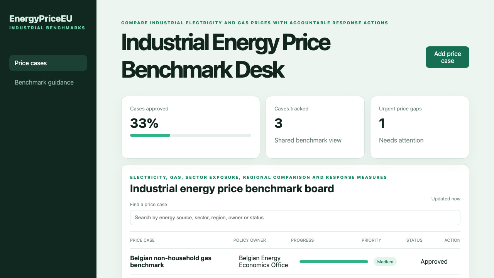

# Industrial Energy Price Benchmark Desk

## One-sentence benefit
Helps industrial teams compare electricity and gas exposure with accountable response actions.

## Live demo
Run both layers locally, then follow [the verified application demo](docs/demo.webm).

## Screenshots

## Main features
Search and sort price cases, create a sector benchmark, progress review and open comparison guidance.

## Technology used
Vue, TypeScript, Pinia, Vue Router, Vite, Spring Boot and Java.

## Installation instructions
Start `cd backend && mvn spring-boot:run`, then run `npm install && npm run dev` in another terminal.

## Commercial licensing/contact
Commercial licensing and implementation support are available through the repository owner.

## Business problem and users
Industry associations, energy economists and public agencies need comparable prices, reference periods and policy owners.

## Key workflows
Filter price cases, add a Benelux sector benchmark, advance its status and review benchmark guidance.

## Vue framework highlights
Composition API, Pinia computed state, reactive filters and Vue Router pages provide the experience.

## Java backend highlights
Spring Boot provides real list, search, create and update endpoints, validation, clear errors, health reporting and tests.

## Architecture and state flow
Pinia owns shared state and synchronises it with the Java API after reads and writes.

## Accessibility and responsive behaviour
Landmarks, labels, visible focus, readable status text and responsive panels support keyboard and mobile users.

## Verification commands
Use `npm test`, `npm run build`, and `cd backend && mvn test package`.

## Structure
`src` contains Vue, `backend` contains Java, and `docs` contains verified media.

## Tradeoffs
The in-memory store keeps setup simple; production would add statistical imports, unit conversion and durable history.

## Roadmap
Add Eurostat ingestion, sector weighting, regional comparisons, alerts and multilingual exports.
